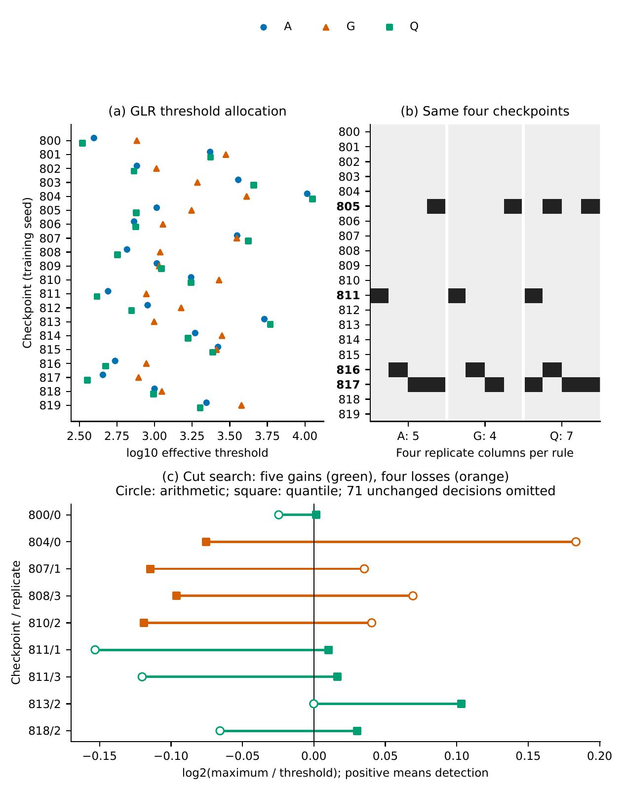

# Threshold Allocation in Checkpoint-Level Calibration

### A Deep Reinforcement Learning Case Study

**Sooyoung Jang, Sungpil Woo, and Ahyun Lee**  
Hanbat National University, Republic of Korea

> **Scope:** research code, processed inputs, and numerical reproduction for Hopper and Walker2d checkpoint comparisons. Manuscripts and internal review records are kept outside the public file set.



*Walker2d example. A/G/Q denote arithmetic, geometric, and 0.90-quantile normalization. The upper panels use eight-stream GLR calibration with total alarm cap two. The lower panel compares arithmetic and quantile cut search with matched six-stream target estimation and frozen/updating caps 4/1.*

## Overview

A reported monitoring comparison depends on which records estimate a scale, which checkpoints are excluded, and which stable observations select the global tuning level. This project makes those choices explicit and traces their effects on thresholds, detected streams, alarm counts, and delays.

The code supports three controlled comparisons: matching estimation memberships across normalizers; removing the leave-one-checkpoint-out (LOCO) correction while fixing records, divisors, and caps; and omitting a checkpoint while comparing identical retained evaluation IDs. A separate exact-rational audit checks threshold propagation from recorded binary64 inputs.

The evidence is retrospective. Empirical alarm caps are not probability guarantees, and these dependent comparisons do not establish a population ranking or deployment performance.

## Repository layout

```text
src/                         numerical/statistic implementation and supporting modules
experiments/
  panel_d_baselines/scores/   processed Hopper score paths
  panel_e_baselines/scores/   processed Walker2d score paths
  confirmation_panel/        frozen Hopper stream summaries and thresholds
  walker_panel/              frozen Walker2d stream summaries and thresholds
  stable_holdout/            additional stable-stream maxima
  revision_20260929_r3/       original cached-path analysis and independent audit
  revision_20260930_r4/       membership, correction, quantile, and omission diagnostics
scripts/                     numbered runners and publication-file checks
reports/                     result CSVs, reproduction instructions, expected hashes
assets/                      figure preview used by this README
```

Scientific paths and identifiers retain their original names. `.gitignore` explicitly admits the public inputs and supporting files. It excludes manuscripts, manuscript-text templates, correspondence, planning/audit histories, document-build tools, old delivery archives, generated numerical tables, and unrelated experiment folders. These local files are retained on disk.

## Installation

Use Python **3.11**. The numerical pipeline needs only NumPy, pandas, SciPy, and PyYAML; their versions match the original environment lock.

```bash
python3.11 -m venv .venv
source .venv/bin/activate
python -m pip install -r requirements.txt
```

`pyproject.toml` and `uv.lock` retain the wider original research environment. GPU, MuJoCo, trained policies, and LaTeX are not required for the public reproduction commands.

## Data

Processed score paths cover **40 independently trained policies**: 20 Hopper checkpoints and 20 Walker2d checkpoints, with **960 original streams** in total. Additional stable caches contain maxima, so they cannot supply indexed stopping times. The primary changed condition gradually reduces gravity while policy updating continues.

Inputs are already included. No simulator data download is needed. Raw transitions, replay buffers, trained weights, and fitted detector arrays are excluded. Large generated CSVs are also excluded; the runners regenerate them and compare their hashes with [the frozen numerical manifest](reports/reproduction_manifest.json).

## Reproducing the results

Start with the small deterministic example, then run the full numerical analysis:

```bash
bash scripts/01_example.sh
bash scripts/02_reproduce.sh
```

The example independently checks **216 decisions at eight operating points**. The full pipeline regenerates **69 numerical CSVs**, **eight diagnostic-input files**, and **nine exact-reference files**, and checks their membership, byte counts, and SHA256 hashes. It also reproduces the 84 exact effect summaries and 1,584 finite-input sensitivity scenarios, then independently checks all 5,968,512 sensitivity decisions. Independent and adverse-case checks run for each analysis stage.

Outputs go to `outputs/minimal/` and `outputs/reproduction/`; these directories are ignored by Git. Every run requires a fresh destination. To retain multiple runs:

```bash
bash scripts/02_reproduce.sh outputs/reproduction-second-run
```

The runner builds a separate worktree from the declared public inputs and prints each stage as it starts. It leaves the supplied inputs unchanged. Allow about 15 minutes and roughly 3 GB of free disk space for the full numerical run. [Reproduction details](reports/reproduction.md) explain the outputs and checks; [the verification receipt](reports/verification.json) records the tested public export.

## Selected results

| Controlled comparison | Recorded outcome | Achieved stable alarms |
|---|---|---|
| Hopper pooled cut search, zero caps: remove LOCO correction and retune | Primary detections **17 → 55 / 80** | Both rules: **0 frozen, 0 updating**, each out of 80 |
| Hopper arithmetic cut search, matched six-stream targets, caps 4/2: same control | Primary detections **73 → 72 / 80** | Both rules: **0 frozen, 2 updating**, each out of 80 |
| All 84 paired correction-removal controls | **54** preserve the primary detected set | Set equality alone does not imply unchanged delays or stable decisions |

The gain and adverse example use different normalizers and cap constraints. Neither is a universal improvement claim. [Results and identifiers](reports/results.md) link these statements to the included CSVs.

## Public-file checks

```bash
python scripts/check_public_tree.py
git status --short
```

The checker validates Git's tracked and non-ignored file set, flags any ignored file that is already tracked, and rejects unlisted files or generated files at or above 100 MB. It does not stage, commit, or upload anything. Manuscript compilation remains a separate local workflow.

## Scope and limitations

Reproduction starts from processed inputs. It does not rerun policy training, collection, detector fitting, or raw-score reconstruction. The previously blocked Panel B recovery is excluded. New-checkpoint validation and untouched evaluation of retrospectively selected families remain open. Counts, detected sets, delays, and held-out stable performance must be assessed separately.

## Citation

For the code and processed-input reproduction:

```bibtex
@misc{jang2026checkpointcalibration,
  title  = {Threshold Allocation in Checkpoint-Level Calibration: Code and Processed-Input Reproduction},
  author = {Jang, Sooyoung and Woo, Sungpil and Lee, Ahyun},
  year   = {2026},
  url    = {https://github.com/pz1004/per-checkpoint-calibration-drl}
}
```

## License

Original project code is licensed under the [MIT License](LICENSE), copyright
2026 Sooyoung Jang, Sungpil Woo, and Ahyun Lee.

The WATCH-derived module, `src/rl_hanbat/socis/watch.py`, retains the upstream
BSD-3-Clause terms. See [Third-party notices](THIRD_PARTY_NOTICES.md) for its
copyright, pinned source revision, and complete license text.

## Acknowledgement

This work was supported by the National Research Foundation of Korea (NRF), funded by the Korea government (MSIT), grant RS-2026-25602117.
